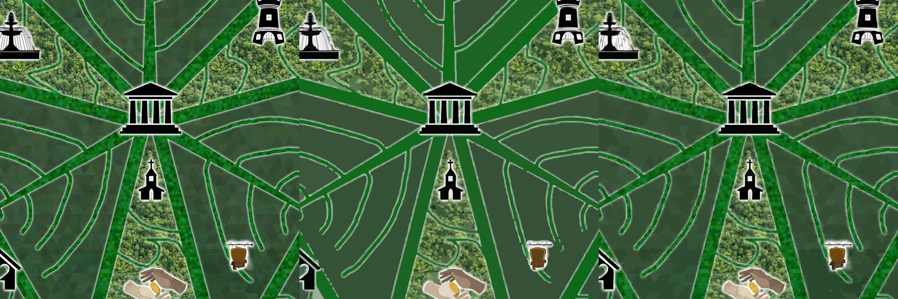

# Coffre des cartes connues

Le coffre est accessible depuis la dernière case du hub à `coffre/`, ou
`/suriel/coffre/` sur GitHub Pages. Son arbre présente les cartes et leurs
régions parentes, que l'on peut replier ; les liens directs et les langues
française et anglaise restent disponibles. Le dossier « Lumerive » est un
regroupement d'affichage : les fichiers sources et les liens ne changent pas.

## Représentation

Les 12 cartes actuelles sont des images JPG. Aucune n'est vectorisée : les
arbres, reliefs, rivières, textes et textures restent des pixels, pas des
objets géographiques éditables. Une vectorisation automatique essayée sur un
extrait d'Abilün a simplifié les forêts et produit des SVG plus lourds :

| Extrait de 800 × 800 pixels | Poids | Tracés | PSNR RGB |
| --- | ---: | ---: | ---: |
| SVG VTracer, précision 4 | 3 893 466 octets | 3 556 | 22,19 dB |
| SVG VTracer, précision 8 | 7 720 199 octets | 7 902 | 24,49 dB |
| WebP qualité 92 | 182 328 octets | — | 38,04 dB |
| WebP sans perte | 752 584 octets | — | Pixels identiques |

Ce seul extrait ne prouve pas le résultat pour toutes les cartes. Une vraie
édition des objets demanderait les données d'origine ou un redessin manuel.

Les cartes sont converties localement en **WebP qualité 90 avec perte** :
elles ne sont pas identiques pixel par pixel aux sources. La compression peut
introduire des artefacts, surtout sur les textes et contours fins ; examiner
ces zones à taille réelle. La résolution d'origine est conservée.

Jusqu'à 16 millions de pixels et 16 383 pixels par côté, chaque carte utilise
une image WebP ; au-delà, elle utilise une pyramide Deep Zoom de tuiles
512 × 512 avec un recouvrement d'un pixel. Actuellement seule la carte du monde
est tuilée : la visionneuse OpenSeadragon ne charge que les zones nécessaires.
Les miniatures utilisent la qualité 85. Les sources JPG et PNG, leur
orientation EXIF et la transparence PNG sont prises en compte sans modifier
les fichiers originaux.

Le lot actuel occupe environ 30,6 Mio dans `public/maps_converted/`,
contre 156,8 Mio et 1 045 fichiers pour l'ancienne version sans perte qui
comprenait une carte supplémentaire. La carte du monde représente 16,1 Mio ;
le site construit avec `/suriel/` occupe 60,1 Mio. Les autres cartes sont
chargées intégralement : cela réduit le nombre de fichiers, mais demande plus
de mémoire pour les plus grandes d'entre elles.

Sur trois extraits de 513 × 513 pixels comparés localement à leurs sources,
le PSNR RGB est de 38,28 dB pour Abilün, 37,04 dB pour Mersa (Ville Basse)
et 45,50 dB pour une tuile du monde. Ces mesures ne garantissent pas la
qualité visuelle de toutes les zones.

## Ajouter ou remplacer une carte

Suivre le [guide des cartes](../guides/map-creation.md). L'assistant convertit
une image à la fois, sans avoir besoin des autres sources. Il vérifie la
présence des sorties des autres cartes avant de modifier le catalogue.
`Dal.jpg` est présenté comme **Olik (capitale)** selon la confirmation du
propriétaire ; ne pas inventer les noms des futures cartes.

Le [catalogue publié](../public/maps_converted/catalog.json) est l'inventaire :
il conserve les noms, régions, identifiants stables, emplacements des sorties,
empreintes SHA-256 et paramètres de conversion. Les sorties comprennent une
couverture et, pour chaque carte, une miniature et soit `image.webp`, soit
`tiles.dzi` et ses tuiles. Le nom du fichier source est publié, mais jamais
son chemin absolu.

Les URL comportent une révision dépendant de la source, des paramètres et des
versions Sharp. Incrémenter `SETTINGS.revision` après toute modification de la
logique de conversion. Si une sortie existante diffère, une nouvelle révision
est créée sans écraser l'ancienne. La conversion ne supprime jamais les
anciennes révisions : inventorier les dossiers non référencés et demander
confirmation avant de supprimer uniquement ces sorties, jamais les originaux.
En cas d'échec, ne pas publier avant d'avoir corrigé la cause ; une sortie
partielle non référencée peut rester à examiner.

Le convertisseur limite libvips à deux threads. Le build normal utilise les
fichiers déjà générés et ne relance pas la conversion. Aucun contenu n'est
envoyé à un service externe pendant la conversion.

## Cache et limites

Les cartes ne sont pas mises dans le cache hors connexion non borné du service
worker ; le navigateur peut les conserver dans son cache HTTP. Leur disponibilité
hors connexion n'est donc pas garantie. OpenSeadragon et sa licence sont copiés
localement au build, sans CDN.

Vérifier la taille de `dist/` après chaque ajout : GitHub Pages annonce une
limite de site de 1 Go et une limite souple de bande passante de 100 Go/mois.
Voir les [limites GitHub Pages](https://docs.github.com/en/pages/getting-started-with-github-pages/github-pages-limits).
Les cartes très détaillées et les grands PNG transparents méritent une
comparaison visuelle particulière ; la qualité 90 ne garantit pas l'absence
d'artefacts. Confirmer les droits de publication et les crédits des futures
cartes.
